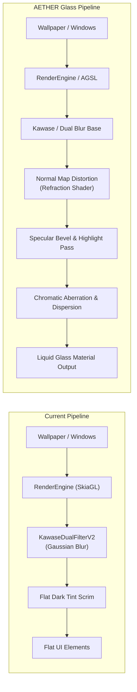

# PROJECT AETHER — Implementation Gap Analysis

> **Phase 0 Reconnaissance Deliverable**
> **Target:** OnePlus Nord 2 5G (`denniz` / `op6893`)
> **ROM:** Evolution X 17.0 (v12.3-20261024-Unofficial)
> **Base Architecture:** Android 16/17 (SDK 37 / Baklava-CinnamonBun) with `SystemUIGoogle` and Axion `AxBlur`
> **Objective:** Bridge current Evolution X SystemUI to Apple-inspired Native "Liquid Glass" Experience.

---

## 1. Executive Summary

Reverse-engineering reconnaissance of the connected OnePlus Nord 2 (`DN2103`, `denniz`) has revealed an unexpected architectural advantage: **the ROM is not running standard vanilla AOSP blur**. Instead, it is running a custom hybrid:
1. **Application Layer:** `SystemUIGoogle.apk` (Pixel-derived base) integrating the **AxionOS `AxBlur` framework** (`com.android.axion.blur.BlurEngine`, `AxBlurSurfaceKt`), Compose Scene Architecture (`SceneTransitionBlurViewModel`), and custom Evolution X settings (`qs_show_volume_slider=3`, `qs_tile_icon_shape=circle`, `qs_tile_label_hide=1`).
2. **Framework Layer:** Android 16/17 (SDK 37), using ViewBinder / ViewModel patterns across Volume, Quick Settings, and Keyguard.
3. **Compositor Layer:** SurfaceFlinger running `debug.renderengine.backend=skiaglthreaded` with `ro.surface_flinger.supports_background_blur=1` and the `KawaseDualFilterV2` blur algorithm.
4. **Hardware Layer:** MediaTek Dimensity 1200 (MT6893) with Mali-G77 MC9, supporting OpenGL ES 3.2, Vulkan 1.1, and hardware framebuffer fetch (`GL_EXT_shader_framebuffer_fetch`).

While background blur is actively running on the device (evidenced by live dumpsys and `qs_screen.png`), the current visual treatment is **flat Gaussian/Kawase blur with dark tinting**, completely lacking the optical depth, specular edge highlights, chromatic aberration, fluid refraction, and thickness characteristic of Apple's Liquid Glass.

---

## 2. Component-by-Component Gap Analysis

### 2.1 Quick Settings (QS) Architecture

| Dimension | Current State (Evolution X 17.0) | AETHER Target (Liquid Glass) | Gap Severity | Identified Integration Point |
|---|---|---|---|---|
| **Panel Backdrop** | Uniform KawaseDualFilterV2 blur with dark semi-transparent tint (`backgroundBlurScale=0.999515`) | Multi-layered frosted glass with dynamic edge illumination, chromatic dispersion, and depth refraction | 🔴 High | `com.android.axion.blur.BlurEngine` / `QSContainerImpl` |
| **Tile Surfaces** | Flat circular shapes (`qs_tile_icon_shape=circle`), solid accent color fill (Active: `#96CBFF`, Inactive: Dark grey) | Translucent convex glass lenses, inner bevel specular highlight, dynamic light refraction over blurred background | 🔴 High | `QSTileViewImpl.createTileShape()` / Compose `AxBlurSurfaceKt` |
| **Brightness & Volume Sliders** | Standard rectangular track with rounded caps, solid thumb/fill (`BrightnessSliderView`, `VolumeDialogSlider`) | Floating cylindrical glass capsule with fluid fill, refractive bubble meniscus, and haptic spring response | 🟡 Medium | `BrightnessSliderView.java` / `VolumeDialogSlider` |
| **Header & Footer** | Standard text and icon widgets with static alphas, data usage counter (`1.22 GB used today`) | Integrated glass navigation bars with blurred backdrop boundaries and smooth alpha falloff | 🟢 Low | `ShadeHeaderController.kt` / `QSFooterView` |

### 2.2 Notification Shade Architecture

| Dimension | Current State (Evolution X 17.0) | AETHER Target (Liquid Glass) | Gap Severity | Identified Integration Point |
|---|---|---|---|---|
| **Notification Cards** | Material You opaque/translucent surface containers (`colorSurfaceVariant`) | Individual semi-transparent glass plates with ambient refraction and inter-card light bleeding | 🔴 High | `ExpandableNotificationRow.java`, `NotificationBackgroundView.java` |
| **Shade Expansion Dynamics** | Linear/quadratic scrim alpha ramp mapped via `PanelExpansionStateManager` | Physical fluid stretch: blur radius, refraction index, and chromatic split dynamically animate with pull velocity | 🟡 Medium | `ScrimController.java` (`applyAndDispatchState()`), `BlurUtils.java` |
| **Stack Scroll & Occlusion** | Rigid vertical stacking with standard clipping | Glass occlusion layering: cards behind refract through cards in front with optical depth degradation | 🔴 High | `NotificationStackScrollLayout.java`, `StackScrollAlgorithm.java` |

### 2.3 Volume Panel

| Dimension | Current State (Evolution X 17.0) | AETHER Target (Liquid Glass) | Gap Severity | Identified Integration Point |
|---|---|---|---|---|
| **Dialog Container** | `TYPE_VOLUME_OVERLAY` window with `setBlurBehindRadius` (controlled by `isVolumeAndPowerBlurEnabled`) | Floating glass pill detached from edges, casting soft optical shadow and subtle backdrop refraction | 🟡 Medium | `VolumeDialogImpl.java` / `VolumeDialogViewBinder.kt` |
| **Slider Tracks** | Traditional vertical/horizontal progress seekbar | Fluid glass reservoir with dynamic liquid level, meniscus tension, and audio level reactivity | 🔴 High | `VolumeDialogSliderType.java` / `VolumeRow` |

### 2.4 Lock Screen (Keyguard)

| Dimension | Current State (Evolution X 17.0) | AETHER Target (Liquid Glass) | Gap Severity | Identified Integration Point |
|---|---|---|---|---|
| **Clock Presentation** | EvoX calligraphy cursive clock ("Monday") rendered as standard 2D vector text | 3D-lit glass typography: highlights along glyph edges, casting dynamic optical shadows on wallpaper | 🟡 Medium | `KeyguardStatusView.java` / `ClockPlugin` |
| **Shortcuts & Biometrics** | Flat optical fingerprint icon (`UdfpsObserver`), standard camera/torch shortcuts | Optical glass disc over UDFPS sensor with interactive refraction ripples on touch down | 🟡 Medium | `UdfpsView.java`, `KeyguardBottomAreaView.java` |
| **Media Player Card** | Standalone QS/Lockscreen media card with simple bitmap blur from album art | Edge-to-edge liquid glass container refracting blurred album art colors with live specular highlights | 🔴 High | `MediaControlPanel.java`, `MediaCarouselController.java` |

---

## 3. Rendering Pipeline Gaps

### 3.1 Shader Pipeline Gaps
- **Missing Normal/Displacement Maps:** The current system has zero concept of surface curvature or normals. To render realistic glass lenses, every UI element (tiles, sliders, cards) requires a signed distance field (SDF) or precomputed normal map to calculate refraction angles.
- **Absence of Specular Lighting:** Current SystemUI views draw flat color fills without simulating virtual light sources (light angle, specular power, Fresnel reflection).
- **No Framebuffer Distortions:** The current `BlurEngine` only sets window blur radius or captures view hierarchies without running fragment distortion shaders over the composited backdrop.

### 3.2 Performance & Budget Gaps
- **Screen Refresh Rate:** Running at **90.0 Hz** (`mDefaultPeakRefreshRate: 90.0`), giving a hard frame budget of **11.11 ms**.
- **SurfaceFlinger Frame Times:** App duration is currently ~17.0 ms, with SF duration ~15.6 ms. HWC missed frame count is already at `36,960` frames under routine operation.
- **Client Composition Overhead:** SurfaceFlinger dump proves that whenever blur is active, HWC composition (`DEVICE`) drops to GPU client composition (`CLIENT`/`SkiaGL`). Injecting expensive multi-pass shaders without strict downsampling or caching will immediately cause jank at 90 Hz.

---

## 4. Integration Strategy Options

Three architectural paths were evaluated for integrating the AETHER Glass Engine into Evolution X SystemUI:

### Path A: Framework-Level Native Engine (Recommended)
* **Mechanism:** Extend the existing `com.android.axion.blur.BlurEngine` and add an AGSL/RuntimeShader-driven `GlassEngine` directly into `SystemUIGoogle`.
* **Pros:**
  - Fully native performance; leverages existing Dagger DI (`SystemUIComponent`) and Compose extensions.
  - Can intercept `QSTileViewImpl`, `BrightnessSliderView`, and `VolumeDialogImpl` directly.
  - Seamless integration with the existing `ro.surface_flinger.supports_background_blur=1` pipeline.
* **Cons:** Requires rebuilding and repackaging `SystemUIGoogle.apk` (or modifying Evolution X `frameworks/base` source).
* **Maintainability:** High — isolates glass logic in a clean modular engine (`com.aether.glass`).

### Path B: Runtime Resource Overlay (RRO) + Vector Replacement
* **Mechanism:** Create RRO packages targeting `com.android.systemui` to replace drawables (`qs_tile_background`, etc.) with semi-transparent vector gradients.
* **Pros:** No binary modification; flashless/rootless.
* **Cons:** Cannot achieve real-time refraction, dynamic specular lighting, or physical glass behavior — limited to static faux-glass textures.
* **Maintainability:** Very high, but visually inadequate.

### Path C: SurfaceFlinger / RenderEngine Skia Customization
* **Mechanism:** Patch SurfaceFlinger RenderEngine (`libs/renderengine/skia/`) to replace `KawaseDualFilterV2` with a custom Glass/Refraction compositor shader.
* **Pros:** Applies system-wide glass effect to all blurred surfaces automatically.
* **Cons:** Extremely high risk of bootloop; requires patching native C++ libraries (`libsurfaceflinger.so`); MediaTek HWC compatibility hazards; difficult to tune on a per-view basis.
* **Maintainability:** Very poor across ROM updates.

---

## 5. Architectural Recommendation

**Path A (Native Modular Engine in `SystemUIGoogle`) is the definitive choice.**
Since `SystemUIGoogle.apk` on this ROM already incorporates Axion's `AxBlur` module and Jetpack Compose runtime, the cleanest, safest, and most maintainable way forward is to build **AETHER Glass Engine as an extension to `com.android.axion.blur`**:
1. Implement `AetherGlassShader` using Android's native **AGSL (Android Graphics Shading Language)** via `RuntimeShader`.
2. Hook `QSTileViewImpl` and `BrightnessSliderView` through a custom `AetherGlassDrawable` that binds to the underlying `BlurEngine` view-tracking lifecycle.
3. Optimize GPU execution using `GL_EXT_shader_framebuffer_fetch` and pre-allocated quarter-resolution offscreen buffers, staying strictly within the 11.11 ms frame budget.
