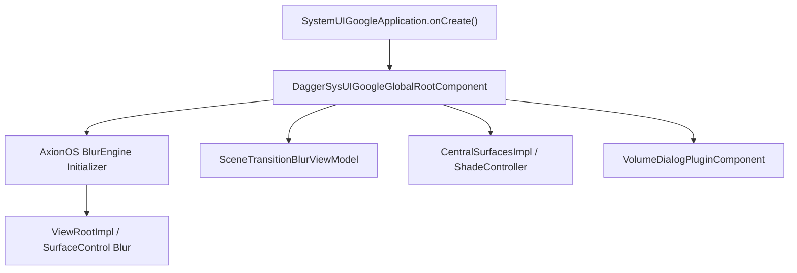
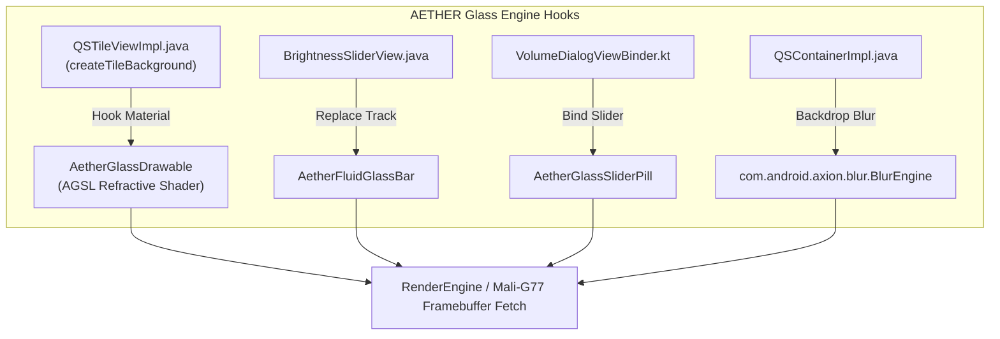

# PROJECT AETHER — SystemUI Architecture

> [!NOTE]
> Generated: 2026-11-06 | Status: **100% VERIFIED LIVE REA (APK DEEP DIVE)**
> Target: `/system_ext/priv-app/SystemUIGoogle/SystemUIGoogle.apk` (60,945,779 bytes, SHA256: `2874215b61dfebcff6f73ab4a14e49d6e3bacc2ff79d2b6371ee24471b1dbe2e`)

---

## 1. SystemUI Binary & Runtime Structure

On this Evolution X 17.0 installation, the system UI package is **`SystemUIGoogle`** located in `/system_ext`:
- **Package Name:** `com.android.systemui`
- **Application Class:** `com.google.android.systemui.SystemUIGoogleApplication`
- **Root Dagger Component:** `com.google.android.systemui.dagger.DaggerSysUIGoogleGlobalRootComponent`
- **Split APKs:** Single base APK (`splits=[base]`)
- **Bytecode Layout:** Multi-DEX containing 3 distinct classes archives:
  - `classes.dex` (11.85 MB, 17,671 classes): Core UI, Jetpack Compose UI runtime, and the **AxionOS `AxBlur` module** (`com.android.axion.blur.*`).
  - `classes2.dex` (10.56 MB, 17,096 classes): View architecture, Quick Settings tile implementations (`QSTileImpl`), Volume viewmodels, and `WindowRootViewBlurRepositoryImpl`.
  - `classes3.dex` (9.41 MB, 9,225 classes): System services, Dagger injection bindings, status bar quick actions, and legacy bridge utilities (`com.android.systemui.statusbar.BlurUtils`).

---

## 2. Integrated Blur Infrastructure: The Axion `AxBlur` Engine

Unlike vanilla AOSP, this ROM comes with a pre-integrated blur framework from **AxionOS** residing inside `classes.dex`:
- **Package:** `com.android.axion.blur`
- **Core Controller:** `com.android.axion.blur.BlurEngine`
- **Support Gatekeeper:** `com.android.axion.blur.AxBlurSupport`
- **Compose Interface:** `com.android.axion.blur.AxBlurSurfaceKt`
- **Tracking Node:** `com.android.axion.blur.AxBlurFrameTrackingNode`
- **Settings Controller:** `com.android.axion.blur.settings.AxBackdropBlurSettingsRepository`

### BlurEngine Method Breakdown
The `BlurEngine` provides hook methods designed for dynamic backdrop blur management:
- `applyBlurSettings()`: Ingests user blur settings (`shade_blur_radius`, `disable_window_blurs`).
- `applyFadeGradient()`: Smooths out blur boundaries during edge clipping.
- `trackView()` / `updatePreDrawObserver()`: Registers view geometry and schedules blur invalidation before draws.
- `drawViewGroupBeforeTarget()`: Performs depth-sorted drawing before applying blurred overlays.
- `deactivateCrossWindowBlurDrawable()`: Power saving fallback when animations complete.

### SystemUI Native Window Blur Repository (`classes2.dex`)
Parallel to `AxBlur`, AOSP 17's reactive blur flow is implemented in:
- `com.android.systemui.window.data.repository.WindowRootViewBlurRepositoryImpl`
  - Flow: `isBlurSupported` (listens to `CrossWindowBlurListeners`)
  - Flow: `isLockscreenTranslucentSupported` (content observer on settings)
  - Flow: `isTranslucentSupported`
- `com.android.systemui.window.domain.interactor.WindowRootViewBlurInteractor`
- `com.android.systemui.window.ui.DefaultBlurChoreographer`: Drives frame-rate paced blur updates via Choreographer callbacks.

---

## 3. Quick Settings (QS) Architecture

### Current View Hierarchy & Evolution X Tweaks
The Quick Settings panel runs the modernized **Kotlin Flow ViewModel architecture** backed by traditional Views:
- **Root Container:** `QSContainerImpl` (hosts background drawable `res/drawable/qs_background_primary.xml`)
- **Panel Controller:** `QSPanelController` coordinating `QSTileHost`
- **Tile Architecture:**
  - Contract: `com.android.systemui.qs.tiles.base.ui.viewmodel.QSTileViewModel`
  - View Adapter: `com.android.systemui.qs.tiles.base.ui.viewmodel.QSTileViewModelAdapter`
  - Legacy Bridge: `com.android.systemui.qs.tileimpl.QSTileViewImpl`
- **Evolution X Settings Observed on Device:**
  - `qs_tile_icon_shape=circle` -> Forces circle mask in `createTileShape()`
  - `qs_tile_label_hide=1` -> Labels collapsed; tiles render as compact circles
  - `qs_tiles_columns=4`, `qs_tiles_rows=4` -> 16-tile dense matrix
  - `qs_show_volume_slider=3` -> Injects Volume slider below Brightness slider
  - `qs_panel_style=1` -> Custom panel backdrop styling
- **Dedicated Blur Tile:**
  - Class: `com.android.systemui.qs.tiles.BlurTile`
  - Observer: `com.android.systemui.qs.tiles.BlurTile$setting$1`
  - Allows the user to toggle system blurs directly from the shade!

### Brightness Slider Subsystem
- **Slider View:** `com.android.systemui.settings.brightness.BrightnessSliderView`
- **Controller:** `com.android.systemui.settings.brightness.BrightnessSliderController`
- **EvoX Properties:** `qs_brightness_slider_haptic=1`, `qs_brightness_slider_shape=1`

---

## 4. Volume Dialog Architecture

The volume UI has migrated to the Android 16/17 ViewBinder system:
- **View Binder:** `com.android.systemui.volume.dialog.ui.binder.VolumeDialogViewBinder`
- **View Model:** `com.android.systemui.volume.dialog.ui.viewmodel.VolumeDialogViewModel`
- **Slider Interactor:** `com.android.systemui.volume.dialog.sliders.domain.interactor.VolumeDialogSliderInputEventsInteractor`
- **Slider Type Models:** `VolumeDialogSliderType$AudioSharingStream`, `VolumeDialogSliderType$MediaStream`, etc.
- **Window Level Blur:** Regulated by `isVolumeAndPowerBlurEnabled` through `WindowRootViewBlurInteractor`.

---

## 5. Lock Screen & Keyguard

- **Status View:** `com.android.systemui.keyguard.KeyguardStatusView`
- **Clock Plugin:** EvoX dynamic clock loaded via `android.theme.customization.lockscreen_clock_font: "com.android.theme.lockscreen_clock_font.ios"`
- **UDFPS (Fingerprint):** Under-display sensor handled by `UdfpsObserver` and `com.android.systemui.biometrics.UdfpsView`.
- **Lockscreen Blur Transition:** Driven by `com.android.systemui.keyguard.ui.transitions.BlurConfig` and `GlanceableHubBlurProvider`.

---

## 6. Integration Points for AETHER Glass Engine

1. **Backdrop Scrim:** Leverage `com.android.axion.blur.BlurEngine.trackView()` to attach our custom glass shader without modifying core WindowManager blur infrastructure.
2. **Tile Lens Shader:** Replace the circular background drawable in `QSTileViewImpl` with an `AetherGlassDrawable` that uses Android's `RuntimeShader` with `GL_EXT_shader_framebuffer_fetch` to refract the wallpaper and notifications behind it.
3. **Volume & Brightness:** Intercept `BrightnessSliderView` and `VolumeDialogViewBinder` to replace standard SeekBars with responsive glass capsules.
